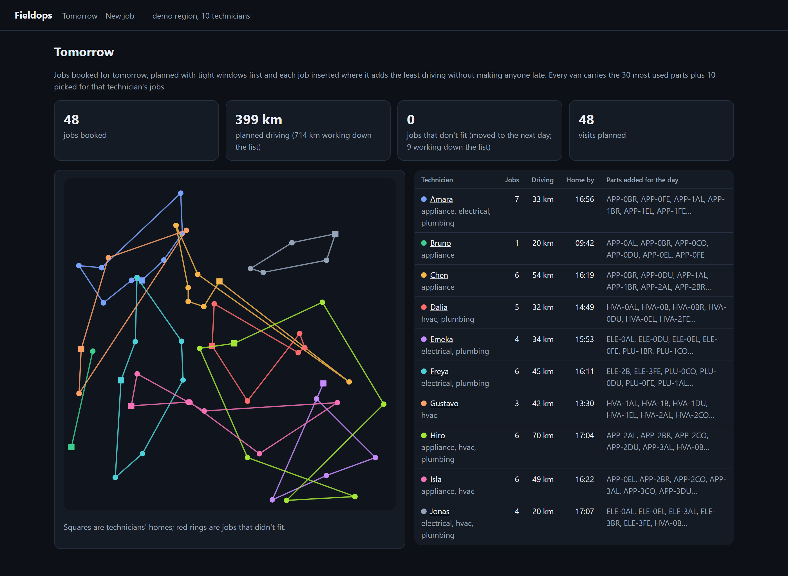
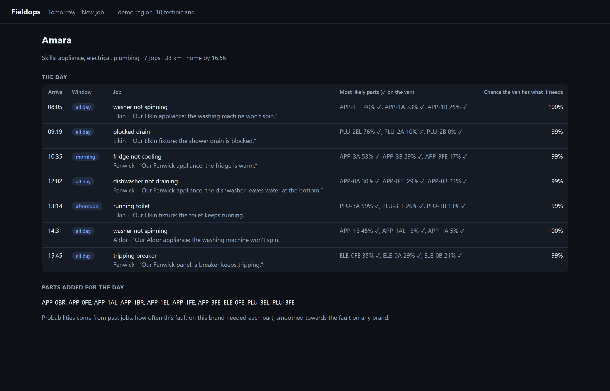

# Field Service Management SaaS

[](https://github.com/codeROCK-IZZY/field-service-management/actions/workflows/ci.yml)


Field service management for the two things customers notice: whether the technician turns up in the window they
waited in for, and whether the job gets fixed on the first visit.

- **Tomorrow's routes are planned, not just assigned.** Tight windows first; each job is inserted where it adds the
  least driving without making anyone late; jobs are then moved between routes while that helps. A planning buffer,
  tuned for each planner, absorbs jobs running long.
- **Each van is loaded for its day.** Thirty slots hold the core parts every van carries; ten are picked for the
  route from what each fault needed on each brand in past jobs.

It also reads customers' job requests with Claude into the service catalogue, and checks the answer.



## Results

`fieldops evaluate --gate` simulates regions of 10 technicians over four weeks, after a history period. Settings
(each planner's buffer, the part model's smoothing) were chosen on 4 tuning regions. These are **10 held-out regions**
(100 technicians, 7,913 jobs). An appointment is **kept** when the job is done on the day it was booked for, inside
the customer's window:

| Planner | Appointments kept | km per job | Overtime h per tech-day | Average days waited |
|---|---:|---:|---:|---:|
| Working down the list (nearest free technician) | 75.7% | 18.7 | 0.09 | 0.27 |
| **Optimised** | **91.7%** | **10.7** | 0.09 | **0.10** |

| First-time fix | Held-out | Shifted (busier, a quarter of brands new) |
|---|---:|---:|
| Standard van kit (40 most used parts) | 72.8% | 72.0% |
| **Kit planned for the day (30 core + 10 for the route)** | **99.6%** | **90.5%** |

In 6 regions held back as **busier, with longer and more variable jobs and new brands**, the optimiser kept 84.4% of
appointments against 60.3%, with 38% less driving per job and less overtime.

What the numbers show:

- **Working down the list scatters technicians.** Each gets jobs across the whole region, so driving takes the day:
  18.7 km per job against 10.7, and a quarter of appointments missed.
- **The baseline was tuned too.** Each planner got its own planning buffer on the tuning regions. With no buffer the
  optimiser packed routes too tight and ran late; with 15% it kept the most appointments.
- **The van kit result is near a ceiling, and that's a property of the simulation:** five jobs a day fit easily into
  ten flexible slots, and faults are assumed correctly diagnosed at booking. Where it really loses ground is **new
  brands**, with no history to say which brand-specific part they need (90.5%). See
  [ADR 2](docs/adr/0002-van-kit-for-the-days-jobs.md).

Synthetic regions and straight-line travel: see [known limitations](docs/known-limitations.md).



## How it works

```
bookings for tomorrow ─► tight windows first ─► cheapest feasible insertion (skills, windows, 17:30) ─► move jobs
                         between routes while it shortens driving ─► routes with arrival times; the rest to tomorrow
past jobs ─► P(part | fault, brand), smoothed towards P(part | fault) ─► 30 core + 10 parts picked for each route
the day ─► real durations ─► kept appointments, km, overtime, first-time fixes
customer's message ─► Claude (strict tool, catalogue enums, quote) ─► fault in skill? quote and brand in message?
```

- **Planning** (`schedule.py`). See [ADR 1](docs/adr/0001-plan-windows-first-cheapest-insertion.md).
- **Van kits** (`parts.py`). See [ADR 2](docs/adr/0002-van-kit-for-the-days-jobs.md).
- **Intake** (`intake.py`). `claude-opus-5-5`, low effort, refusal fallbacks; keyword rules without a key. See
  [ADR 3](docs/adr/0003-job-requests-read-against-the-catalogue.md).

Decisions: [docs/adr](docs/adr). Gaps: [docs/known-limitations.md](docs/known-limitations.md).

## Run it

```bash
python -m venv .venv && . .venv/bin/activate
pip install -e ".[dev]"

fieldops plan                                     # tomorrow's routes for the demo region
fieldops read "Our Garro fridge is warm, please come after lunch"
fieldops serve                                    # the console on http://127.0.0.1:8000
fieldops evaluate --gate                          # eval/reports/report.{md,json,html}
pytest
```

API: `GET /api/plan`, `POST /api/jobs {"text"}`.

## Tests and CI

- **Core:** a deterministic region where every skill is covered and new brands appear only after the history; part
  distributions; arrival times waiting for windows and lateness detected; both planners keeping skills and windows
  and accounting for every job; the optimiser driving less; the day lived with real durations, carrying what can't
  start; the part model's fallback for unseen brands; planned kits beating the standard kit.
- **Services:** job requests **through the real Anthropic SDK** with canned responses (the request shape, a fault
  outside its skill, an unquoted fault, a brand not in the message, a brand with no history, a refusal falling back
  to rules), the console's pages and API, and the CLI.
- **CI:** ruff, `mypy --strict`, tests on Python 3.12 and 3.13, the evaluation gate, the container serving the
  console, and a gitleaks scan of the full history.

## License

MIT
